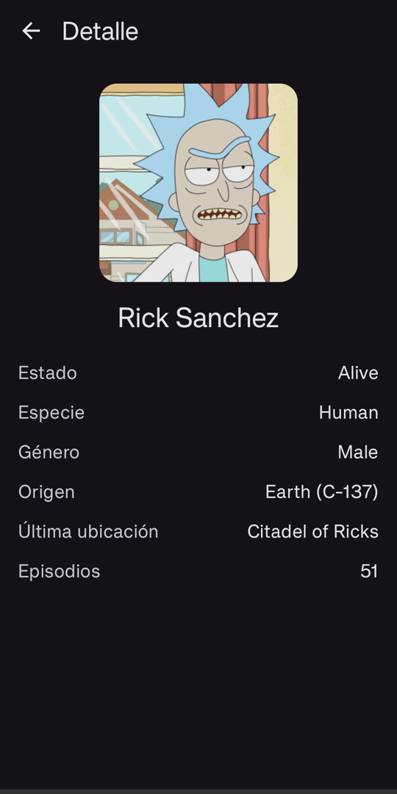

# CharacterFinder

[](https://github.com/jmvines/CharacterFinder/actions/workflows/ci.yml)

App Android de ejemplo para la prueba técnica: busca personajes de Rick & Morty, filtra por
estado (vivos, muertos, desconocido) y muestra su detalle, con arquitectura en capas,
cancelación de búsquedas en curso, caché con expiración y tests unitarios.

<p>
  
  
</p>

## API elegida

[Rick and Morty API](https://rickandmortyapi.com) — pública, sin API key ni registro, con
búsqueda por nombre con filtro de estado opcional (`GET /api/character?name=&status=`) y
detalle por id (`GET /api/character/{id}`).
Peculiaridad a tener en cuenta: responde **404 cuando la búsqueda no tiene coincidencias**; el
repositorio lo traduce a lista vacía (estado "sin resultados", no error).

## Cómo ejecutar

```bash
./gradlew installDebug        # instalar en un dispositivo/emulador conectado
./gradlew test                # tests de todos los módulos
./gradlew :app:testDebugUnitTest  # tests de presentación
./gradlew build               # compilación completa + tests + lint
./gradlew connectedDebugAndroidTest  # test de instrumentación de accesibilidad (requiere dispositivo)
```

Requiere JDK 17 o superior —el bytecode se fija a 17 en los tres módulos— y el SDK de Android
(`compileSdk` 37). No necesita ninguna clave ni configuración.

## Arquitectura

Tres módulos Gradle, con la regla de dependencias apuntando siempre hacia el dominio:

```
:app  (Android, Compose)  ──▶  :domain  (Kotlin puro)  ◀──  :data  (Kotlin puro)
```

- **`:domain`** — modelo `Character`, interfaz `CharacterRepository` y casos de uso
  (`SearchCharactersUseCase`, `GetCharacterDetailUseCase`). Sin ninguna dependencia de Android
  ni de librerías de infraestructura. Al ser un módulo `kotlin-jvm`, cualquier uso de una API de
  Android no compila; que tampoco entren red, DI o serialización es convención revisada a mano.
  No hay test de arquitectura que lo vigile.
- **`:data`** — implementación del repositorio con Retrofit + kotlinx-serialization, DTOs con
  mapper a dominio y la caché de búsquedas.
- **`:app`** — Jetpack Compose + Material 3, un ViewModel por pantalla con `StateFlow` de estado
  inmutable (sealed interface: `Idle/Loading/Empty/Error/Success` en la búsqueda,
  `Loading/Error/Success` en el detalle), Navigation 3 y Koin
  para la inyección de dependencias.

## Cancelación

El texto de búsqueda vive en un `StateFlow` en `SearchViewModel`. Cada tecla emite un request
al instante y `flatMapLatest` **cancela estructuradamente la corrutina de la búsqueda anterior**,
lo que aborta también su llamada HTTP (Retrofit con funciones `suspend` coopera con la
cancelación). El `delay` de 300 ms del debounce vive **dentro** del flow de cada búsqueda, no
aguas arriba:

- el tecleo rápido sigue agrupándose en una sola petición — cada tecla cancela la espera de la
  anterior y arranca la suya —, y
- la búsqueda en vuelo muere en la primera tecla; con el `debounce` aguas arriba sobrevivía la
  ventana de 300 ms y podía publicar su resultado con el campo ya cambiado.

Nunca se publican resultados de una búsqueda obsoleta.

El filtro de estado (chips Todos/Vivos/Muertos/Desconocido) entra en el mismo pipeline como una
**rama inmediata**, fusionada con la del tecleo (`merge`) y deduplicada
(`distinctUntilChanged`): cambiarlo relanza la búsqueda **sin debounce** — es un gesto
deliberado, no tecleo —, emparejado siempre con el texto actual del campo, y cancela igualmente
la que hubiera en curso. Son dos ramas y no un `combine` porque cada request lleva marcada su
fuente — solo la del tecleo espera los 300 ms — y porque `combine` ya causó un bug: emparejaba
el filtro nuevo con el último texto *debounceado* —el anterior—, no con el actual.

Está cubierto por tests (`SearchViewModelTest`): se lanza una búsqueda lenta, se emite otra
antes de que termine y se comprueba que la primera queda cancelada y que la UI solo recibe los
resultados de la segunda; y el caso contrario — una búsqueda vieja con respuesta rápida no
publica nada si el texto cambió mientras la nueva esperaba su debounce.

## Caché

`SearchCache` (`:data`): caché **en memoria por query normalizada** (trim + minúsculas) **y
filtro de estado** — la misma query con filtros distintos son resultados distintos y no se
pisan —, con **TTL de 3 minutos**, **tope de 64 entradas con descarte LRU** y acceso protegido
por `Mutex`.

- Si hay entrada válida, el repositorio la devuelve **sin llamada de red**.
- Si expiró, se elimina, se consulta la red y se refresca la entrada.
- El reloj es **monótono** (`System.nanoTime`), de forma que un cambio de hora del dispositivo no
  altera la expiración, y se inyecta como `() -> Long`, de modo que los tests mueven el tiempo
  sin esperas reales.

## Tests (56 + 1 en dispositivo)

| Módulo | Qué cubre |
|---|---|
| `:domain` (8) | `SearchQuery`: normalización y validez (única fuente de verdad de la validación del query). Casos de uso con repositorio fake: query en blanco no toca el repo, trim, delegación, propagación del filtro de estado |
| `:data` (13) | Caché: hit dentro del TTL, expiración, entradas por query, **claves independientes por filtro de estado**, **descarte de la entrada menos usada al superar el tope**. Repositorio: segunda búsqueda sin red, expiración vuelve a red, normalización de clave, filtro a la API en minúsculas, 404 → lista vacía, 5xx → `Server`, fallo de red → `Connectivity` |
| `:app` (14) | ViewModels con `coroutines-test` + Turbine. Búsqueda: **cancelación de la búsqueda anterior**, debounce, blank → Idle, sin resultados → Empty, fallo → Error, reintento tras error, **cambiar el filtro cancela la búsqueda en curso**, **cambiar el filtro a media escritura no busca con el texto anterior**, **dos cambios de filtro
seguidos relanzan con el texto actual y sin peticiones de más**, **una respuesta rápida de una búsqueda vieja no se publica si el texto cambió durante el debounce**, el reintento conserva el filtro. Detalle: carga del id solicitado, fallo → Error, reintento tras error |
| `:app` semantics (21) | Contrato de accesibilidad en JVM (Robolectric + compose-ui-test, sin emulador): etiquetas, live regions, encabezados de búsqueda y detalle, campos fusionados, rol de botón, posición en lista, cada resultado anunciado con sus campos etiquetados (Nombre/Especie/Estado), supercajas de filtros y de resultados con su recuento, grupo de selección única con rol radio y estado de los chips, título del detalle enfocable para recibir el foco inicial y acción Buscar del teclado |
| `:app` androidTest (1) | Instrumentación en dispositivo real (uiautomator): la supercaja de filtros sobrevive como nodo propio en el `AccessibilityNodeInfo` de la plataforma, junto a sus chips — la capa que una suite JVM no puede ver. Corre con `connectedDebugAndroidTest`; el CI compila ese source set pero no lo ejecuta (no hay emulador) |

## Accesibilidad

Accesibilidad con TalkBack verificada en dispositivo físico: etiquetas, anuncios de los cambios
de estado (cargando, error, sin resultados) mediante live regions, encabezado del detalle para
la navegación por encabezados, flujo de error con reintento y anuncio de la posición en la lista
de resultados ("elemento N de M") vía `collectionInfo`/`collectionItemInfo`. La zona de
filtros es una parada propia del recorrido que **engloba los cuatro chips** y se anuncia
como "Filtro de estado del personaje, 4 opciones"; después el foco entra chip a chip, con **rol radio y
grupo de selección única** (`selectableGroup`), dejando claro que son excluyentes y cuál
está activo. Esa parada es un **nodo hoja** superpuesto al grupo (`matchParentSize`) con la
etiqueta como `contentDescription` — TalkBack salta en la navegación lineal los contenedores
cuyos hijos ya son enfocables, pero nunca una hoja con contenido. Se declara antes de los chips,
de modo que queda por debajo en el dibujado y la exploración táctil sigue cayendo en ellos,
mientras un `traversalIndex` negativo dentro del `isTraversalGroup` la sitúa delante de ellos en
el recorrido lineal; el inset de 1 dp que envuelve el contenido evita que los chips queden con
los mismos límites que la hoja. La lista de resultados tiene su parada equivalente ("Lista de resultados,
N personajes") antes de entrar personaje a personaje, y cada resultado se anuncia con sus
campos etiquetados ("Nombre: … Especie: … Estado: …") en vez del texto visual a secas.
Con un lector activo, el foco inicial
se gestiona en las dos pantallas: al abrir la búsqueda se coloca en el campo (no en los
filtros) y al entrar al detalle, en su título (no en la flecha de volver). De ese contrato, los
21 tests JVM que corren en el CI fijan las etiquetas, los roles, el `traversalIndex` de las dos
paradas, las live regions y la información de colección (ver tabla de tests). Lo que no puede
cubrir una suite JVM son las medidas —el inset de 1 dp— ni el foco inicial, porque
`compose-ui-test` lee el árbol de semantics de Compose y no el `AccessibilityNodeInfo` de la
plataforma, y bajo Robolectric la exploración táctil está apagada. Las medidas las fija ahora un
test de instrumentación (`FilterSupercajaAccessibilityTest`, uiautomator) que comprueba en
dispositivo real que la parada de filtros sobrevive como nodo propio junto a sus chips; el foco
inicial y los anuncios se siguen verificando a mano con TalkBack.

## Integración continua

Workflow de GitHub Actions ([`ci.yml`](.github/workflows/ci.yml)) que corre en cada push a
`main`, en cada pull request y bajo demanda (`workflow_dispatch`, botón "Run workflow" en la
pestaña Actions):

1. **Build completo** (`./gradlew build`): compila y ejecuta en un único paso los tests de los
   tres módulos y el lint de Android (`build` → `check` → `test`), sin correr la suite dos veces.
   Compila también el release minificado, así que un fallo de reglas de R8 rompe el CI.
2. Publica artifacts descargables: los dos cuando el run pasa y los informes de tests también
   cuando falla.
   - `character-finder-debug` — APK de debug instalable, para probar la app sin compilar nada.
   - `informes-de-tests` — informes HTML de Gradle, subidos también cuando los tests fallan
     (`if: always()`), que es cuando más se necesitan.

Corre en `ubuntu-latest` con JDK 17 (Temurin) y caché de Gradle entre runs, y declara
`permissions: contents: read` (mínimo privilegio). El badge de arriba refleja el estado del
último run en `main`.

## Decisiones principales

- **Koin** como DI: ligera y suficiente para este tamaño; los ViewModels reciben casos de uso
  por constructor, lo que permite testearlos sin el framework.
- **Fakes a mano en vez de librería de mocks**: para interfaces de un método son más legibles
  y no añaden dependencias.
- **Errores tipados con `Either<DomainError, T>`** en vez de excepciones: `DomainError`
  distingue `Connectivity` (sin red), `Server` (5xx) y `Unexpected`, y la UI muestra un mensaje
  distinto por causa, con reintento en todos los casos.
- **Validación como tipo (`SearchQuery`)**: la regla de qué es una búsqueda válida vive en un
  value class del dominio; el ViewModel y el caso de uso la comparten sin duplicar el predicado.
  La frontera del repositorio sigue recibiendo `String`, porque la clave de caché necesita además
  pasar a minúsculas, que no es asunto del dominio.
- **Sin Room/persistencia**: el enunciado da por buena la caché en memoria; añadir disco sería
  superficie extra sin requisito que lo pida.
- **Solo la primera página de resultados**: la API pagina de 20 en 20 (`info.next`); para el
  caso de uso — teclear un nombre y afinar la búsqueda — la primera página es suficiente, y
  paginar añadiría scroll infinito y estados intermedios sin requisito que lo pida.
- **Material 3 con los esquemas de color por defecto**, claro y oscuro según el ajuste del
  sistema (`isSystemInDarkTheme`), y pantallas deliberadamente sobrias: el enunciado pide
  claridad, no diseño avanzado.
- **Release minificado con R8** (`isMinifyEnabled = true` + `proguard-android-optimize.txt`) y
  reglas explícitas en `app/proguard-rules.pro` para kotlinx.serialization — los DTOs y los
  `NavKey` `@Serializable` de Navigation 3 viven de la reflexión del plugin —. Verificado en
  dispositivo con el APK de release: búsqueda, detalle y restauración tras muerte de proceso,
  sin errores de serialización.
- **Orientación vertical fija** (`screenOrientation="portrait"`): pantallas de lista y detalle
  pensadas para uso en vertical; es deliberada, y los avisos de lint que genera
  (`LockedOrientationActivity`, `DiscouragedApi`) están aceptados.
