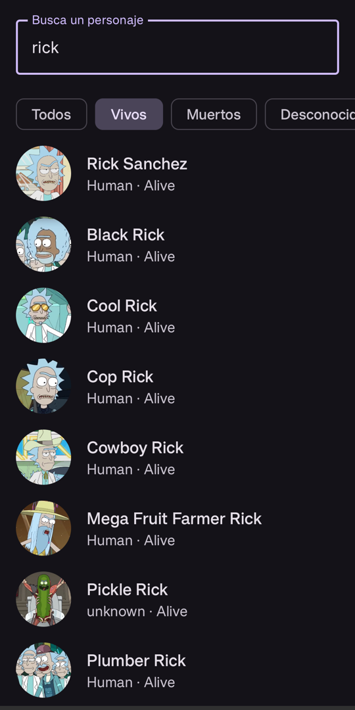

# CharacterFinder

[](https://github.com/jmvines/CharacterFinder/actions/workflows/ci.yml)

App Android de ejemplo para la prueba técnica: busca personajes de Rick & Morty y muestra su
detalle, con arquitectura en capas, cancelación de búsquedas en curso, caché con expiración y
tests unitarios.

<p>
  
  
</p>

## API elegida

[Rick and Morty API](https://rickandmortyapi.com) — pública, sin API key ni registro, con
búsqueda por nombre (`GET /api/character?name=`) y detalle por id (`GET /api/character/{id}`).
Peculiaridad a tener en cuenta: responde **404 cuando la búsqueda no tiene coincidencias**; el
repositorio lo traduce a lista vacía (estado "sin resultados", no error).

## Cómo ejecutar

```bash
./gradlew installDebug        # instalar en un dispositivo/emulador conectado
./gradlew test                # tests de :domain y :data
./gradlew :app:testDebugUnitTest  # tests de presentación
./gradlew build               # compilación completa + tests + lint
```

Requiere JDK 17 y el SDK de Android (`compileSdk` 36). No necesita ninguna clave ni configuración.

## Arquitectura

Tres módulos Gradle, con la regla de dependencias apuntando siempre hacia el dominio:

```
:app  (Android, Compose)  ──▶  :domain  (Kotlin puro)  ◀──  :data  (Kotlin puro)
```

- **`:domain`** — modelo `Character`, interfaz `CharacterRepository` y casos de uso
  (`SearchCharactersUseCase`, `GetCharacterDetailUseCase`). Sin ninguna dependencia de Android
  ni de librerías de infraestructura: no puede "contaminarse" sin que el módulo deje de compilar.
- **`:data`** — implementación del repositorio con Retrofit + kotlinx-serialization, DTOs con
  mapper a dominio y la caché de búsquedas.
- **`:app`** — Jetpack Compose + Material 3, un ViewModel por pantalla con `StateFlow` de estado
  inmutable (sealed interface `Idle/Loading/Empty/Error/Success`), Navigation Compose y Koin
  para la inyección de dependencias.

## Cancelación

El texto de búsqueda vive en un `StateFlow` en `SearchViewModel`. El pipeline
`debounce(300 ms) → flatMapLatest { useCase(query) }` garantiza que:

- el tecleo rápido no dispara una petición por letra (debounce), y
- **una búsqueda nueva cancela estructuradamente la corrutina de la anterior**
  (`flatMapLatest`), lo que aborta también su llamada HTTP (Retrofit con funciones `suspend`
  coopera con la cancelación). Nunca se publican resultados de una búsqueda obsoleta.

Está cubierto por un test (`SearchViewModelTest`): se lanza una búsqueda lenta, se emite otra
antes de que termine y se comprueba que la primera queda cancelada y que la UI solo recibe los
resultados de la segunda.

## Caché

`SearchCache` (`:data`): caché **en memoria por query normalizada** (trim + minúsculas), con
**TTL de 3 minutos** y acceso protegido por `Mutex`.

- Si hay entrada válida, el repositorio la devuelve **sin llamada de red**.
- Si expiró, se elimina, se consulta la red y se refresca la entrada.
- El reloj se inyecta como `() -> Long`, de modo que los tests de expiración mueven el tiempo
  sin esperas reales.

## Tests (36)

| Módulo | Qué cubre |
|---|---|
| `:domain` (4) | Casos de uso con repositorio fake: query en blanco no toca el repo, trim, delegación |
| `:data` (10) | Caché: hit dentro del TTL, expiración, entradas por query. Repositorio: segunda búsqueda sin red, expiración vuelve a red, normalización de clave, 404 → lista vacía, 5xx → `Server`, fallo de red → `Connectivity` |
| `:app` (9) | ViewModels con `coroutines-test` + Turbine. Búsqueda: **cancelación de la búsqueda anterior**, debounce, blank → Idle, sin resultados → Empty, fallo → Error, reintento tras error. Detalle: carga del id solicitado, fallo → Error, reintento tras error |
| `:app` semantics (13) | Contrato de accesibilidad en JVM (Robolectric + compose-ui-test, sin emulador): etiquetas, live regions, encabezado, campos fusionados, rol de botón y posición en lista |

## Accesibilidad

Accesibilidad con TalkBack verificada en dispositivo físico: etiquetas, anuncios de los cambios
de estado (cargando, error, sin resultados) mediante live regions, encabezado del detalle para
la navegación por encabezados, flujo de error con reintento y anuncio de la posición en la lista
de resultados ("elemento N de M") vía `collectionInfo`/`collectionItemInfo`. Ese contrato de
semántica queda además fijado por 13 tests JVM que corren en el CI (ver tabla de tests).

## Integración continua

Workflow de GitHub Actions ([`ci.yml`](.github/workflows/ci.yml)) que corre en cada push a
`main`, en cada pull request y bajo demanda (`workflow_dispatch`, botón "Run workflow" en la
pestaña Actions):

1. **Tests unitarios** de los tres módulos, como paso explícito.
2. **Build completo con lint** de Android (`./gradlew build`).
3. Publica dos artifacts descargables en cada run:
   - `character-finder-debug` — APK de debug instalable, para probar la app sin compilar nada.
   - `informes-de-tests` — informes HTML de Gradle, subidos también cuando los tests fallan
     (`if: always()`), que es cuando más se necesitan.

Corre en `ubuntu-latest` con JDK 17 (Temurin) y caché de Gradle entre runs, y declara
`permissions: contents: read` (mínimo privilegio). El badge de arriba refleja el estado del
último run en `main`.

## Decisiones principales

- **Koin** como DI: ligera y suficiente para este tamaño; los ViewModels reciben casos de uso
  por constructor, lo que permite testearlos sin el framework.
- **Fakes a mano en vez de librería de mocks**: para interfaces de un método son más legibles
  y no añaden dependencias.
- **Errores tipados con `Either<DomainError, T>`** en vez de excepciones: `DomainError`
  distingue `Connectivity` (sin red), `Server` (5xx) y `Unexpected`, y la UI muestra un mensaje
  distinto por causa, con reintento en todos los casos.
- **Sin Room/persistencia**: el enunciado da por buena la caché en memoria; añadir disco sería
  superficie extra sin requisito que lo pida.
- **Solo la primera página de resultados**: la API pagina de 20 en 20 (`info.next`); para el
  caso de uso — teclear un nombre y afinar la búsqueda — la primera página es suficiente, y
  paginar añadiría scroll infinito y estados intermedios sin requisito que lo pida.
- **Material 3 con esquema de color por defecto** y pantallas deliberadamente sobrias: el
  enunciado pide claridad, no diseño avanzado.
